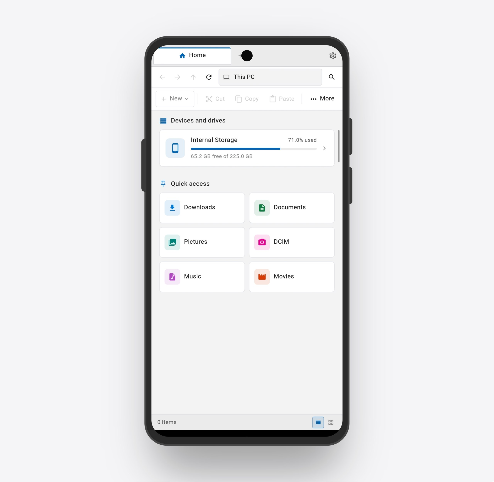
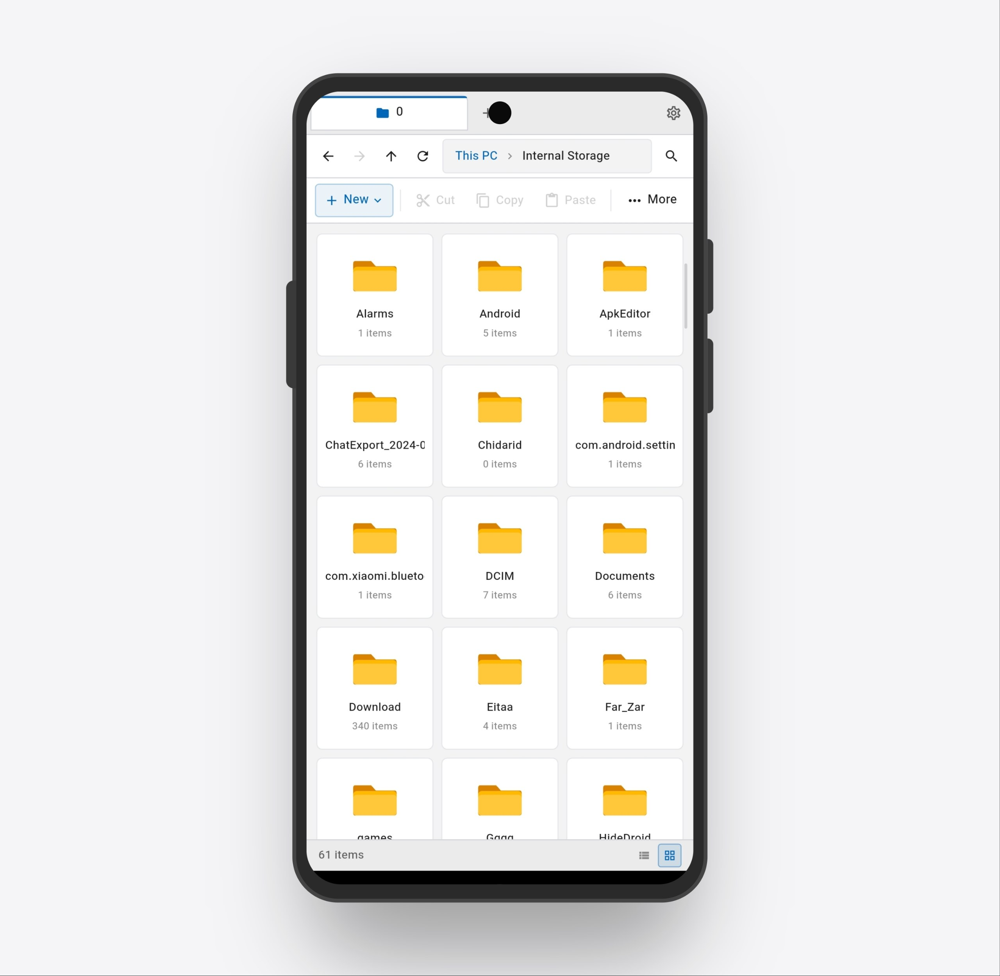
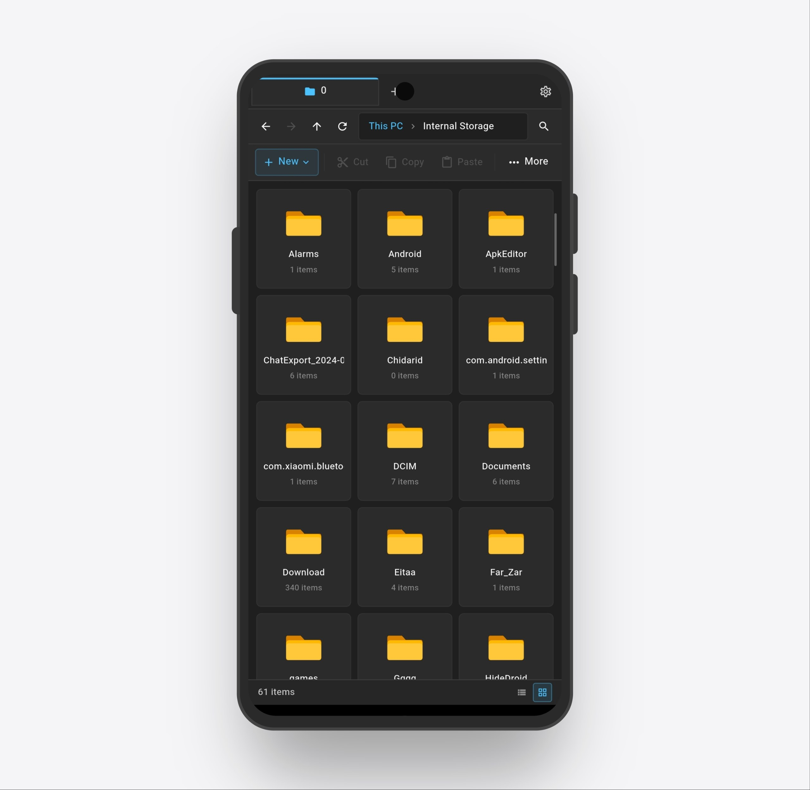
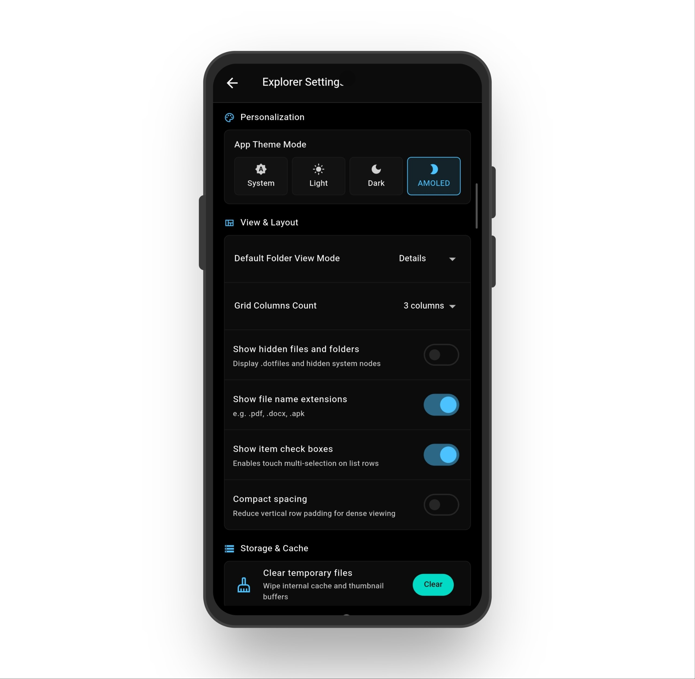
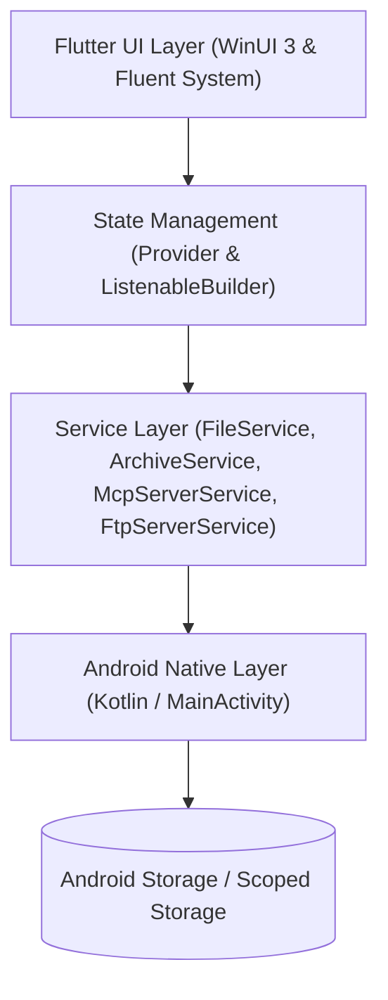

<div align="center">

# NeoFile

**A modern, fluent WinUI-inspired File Manager, Media Suite & Local Server for Android.**

[](https://flutter.dev)
[](https://dart.dev)
[-3DDC84?logo=android&logoColor=white)](https://android.com)
[](https://github.com/AmirrezaKhezerlou/NeoFile/releases)
[](LICENSE)
[](https://github.com/AmirrezaKhezerlou/NeoFile)

<p align="center">
  <a href="#features">Features</a> •
  <a href="#screenshots">Screenshots</a> •
  <a href="#installation--build">Installation & Build</a> •
  <a href="#architecture--tech-stack">Architecture</a> •
  <a href="#license">License</a>
</p>

</div>

---

## Overview

**NeoFile** brings the refined, responsive elegance of Microsoft Windows 11's **Fluent Design System (WinUI 3)** directly to Android. Beyond standard file browsing, NeoFile combines a multi-tab desktop-grade file explorer, a full-featured media and document suite, a visual storage analyzer, and built-in **FTP** and **Model Context Protocol (MCP)** local servers for seamless cross-device file sharing and AI-assisted workflows.

---

## Screenshots

<div align="center">
  <table>
    <tr>
      <td align="center"><b>Home Dashboard (This PC)</b></td>
      <td align="center"><b>Light Mode (Grid View)</b></td>
    </tr>
    <tr>
      <td align="center"></td>
      <td align="center"></td>
    </tr>
    <tr>
      <td align="center"><b>Dark Mode (Fluent Design)</b></td>
      <td align="center"><b>AMOLED Black & Settings</b></td>
    </tr>
    <tr>
      <td align="center"></td>
      <td align="center"></td>
    </tr>
  </table>
</div>

---

## Features

### Desktop-Class File Explorer
- **Multi-Tab Browsing**: Open multiple directories across independent tabs with smooth tab-switching animations.
- **Breadcrumb Navigation Bar**: Interactive WinUI-style address bar with instant folder navigation and root storage access.
- **Command Bar & Multi-Select**: Fast batch operations for *New Folder, Cut, Copy, Paste, Rename, Delete, Share, Zip/Unzip*, and detailed file metadata inspection.
- **Flexible View Modes**: Switch between **Details List, Tiles, and Grid Views** with customizable item density and single/double-line layout modes.
- **Live Background Refresh**: Real-time background detection of file creations, modifications, and deletions.
- **Quick Access & Pinned Folders**: Fast shortcuts to Downloads, Documents, DCIM, Pictures, Music, and user-pinned locations.

---

### Storage Analyzer
- **Interactive Storage Breakdown**: Visual category utilization charts for Videos, Music, Photos, Documents, APKs, and Archives.
- **Deep Directory Inspection**: Sort files by largest-to-smallest to instantly identify storage hogs.
- **Batch Management**: Multi-select and safely delete or move redundant files directly from the analyzer dashboard.

---

### Built-In FTP Server & Client
- **Local Network Wi-Fi File Server**: Wirelessly access the device filesystem from Windows File Explorer, macOS Finder, Linux, or any FTP client.
- **Status & Controls**: Dedicated port management, real-time connected client monitor, anonymous or password-authenticated sessions.
- **Foreground Notifications**: Persistent Android system notification with one-tap disconnect and live status indicators.
- **FTP Client Integration**: Connect to external FTP servers directly within the app to browse, download, and upload files.

---

### Model Context Protocol (MCP) Server
- **AI Agent Integration**: Expose local file operations securely to AI clients (such as Claude Desktop, Cursor, and custom LLM agents) via standard HTTP and Server-Sent Events (SSE).
- **Auto Port Discovery**: Automatic detection of available ports with real-time port validation.
- **Auth Token Security**: Built-in Bearer authentication token management with timing-safe comparison and one-tap token regeneration.

---

### Built-In Media & Document Suite
- **Custom Video Player**:
  - Immersive edge-to-edge fullscreen mode with proper system bar insets.
  - Subtitle track selector supporting external `.srt` and `.vtt` subtitles.
  - Video aspect ratio toggle (Fit, Stretch, Original) and multi-touch playback controls.
- **Audio Player**:
  - Background playback with repeat modes, playlist queue, and audio visualization aesthetics.
- **Integrated PDF Viewer**:
  - In-app high-speed PDF rendering with page index, zoom, and continuous scrolling powered by `flutter_pdfview`.
- **Image Viewer**:
  - Smooth multi-touch pinch-to-zoom, image rotation, bounded memory decoding, and quick-delete with confirmation dialogs.

---

### WinUI 3 Personalization & Themes
- **Fluent UI Themes**: System Default, Windows Light, Mica Dark, and Pure AMOLED Black.
- **Dual-Storage Persistence**: Bulletproof theme memory with secondary file-based backup (`.neofile_theme.txt`) ensuring selections persist across app restarts.
- **Custom Typography**: Adjustable font scale factor and toggleable list details (file size, modification date).
- **Cache & Temp Cleaner**: One-tap cleanup of thumbnail buffers, temporary files, and app cache with real-time progress animations.

---

### Android Home Screen Widgets
- **Interactive Widgets**: Native Android launcher widgets for instant FTP Server control, MCP Server monitoring, and Storage usage.
- **Widgets Gallery**: Dedicated in-app showcase screen in the navigation drawer demonstrating all available home screen widgets.

---

## Architecture & Tech Stack



- **Framework**: [Flutter](https://flutter.dev) (Dart 3)
- **State Management**: `provider` pattern with granular selector updates
- **Local Servers**: Dart `dart:io` `HttpServer` (MCP SSE) & `ServerSocket` (FTP)
- **PDF Engine**: `flutter_pdfview` with native AndroidPdfViewer
- **Audio & Media**: `audioplayers`, `video_player`
- **Native Platform Channels**: Kotlin MethodChannels for AppWidgets, StorageStats, system notifications, and `ACTION_VIEW` intent resolution

---

## Installation & Build

### Prerequisites
- [Flutter SDK](https://docs.flutter.dev/get-started/install) (3.24+ recommended)
- [Android Studio / SDK](https://developer.android.com/studio) (API 26+)
- Java JDK 17+

### 1. Clone the Repository
```bash
git clone https://github.com/AmirrezaKhezerlou/NeoFile.git
cd NeoFile
```

### 2. Install Dependencies
```bash
flutter pub get
```

### 3. Run in Debug Mode
```bash
flutter run
```

### 4. Build Optimized Release APKs (Split per ABI)
Building with `--split-per-abi` significantly reduces download size:
```bash
flutter build apk --release --split-per-abi
```

Generated APKs will be located in:
- `build/app/outputs/flutter-apk/app-arm64-v8a-release.apk` (~25 MB - Modern 64-bit phones)
- `build/app/outputs/flutter-apk/app-armeabi-v7a-release.apk` (~21 MB - 32-bit legacy devices)
- `build/app/outputs/flutter-apk/app-x86_64-release.apk` (~26 MB - Android emulators)

---

## Permissions & Security

NeoFile requires the following Android permissions to function as a complete file manager:
- `android.permission.MANAGE_EXTERNAL_STORAGE`: Required to access, organize, and manage files on Android 11+ (API 30+).
- `android.permission.INTERNET` & `ACCESS_NETWORK_STATE`: Required for the local FTP and MCP servers.
- `android.permission.POST_NOTIFICATIONS`: Required for background transfer and server status notifications.
- `android.permission.FOREGROUND_SERVICE`: Required for background FTP/MCP stability during active connections.

---

## Contributing

Contributions, issues, and feature requests are welcome.  
Feel free to check out the [issues page](https://github.com/AmirrezaKhezerlou/NeoFile/issues).

1. Fork the Project
2. Create your Feature Branch (`git checkout -b feature/AmazingFeature`)
3. Commit your Changes (`git commit -m 'feat: add AmazingFeature'`)
4. Push to the Branch (`git push origin feature/AmazingFeature`)
5. Open a Pull Request

---

## License

This project is open-source and licensed under the [MIT License](LICENSE).

---

<div align="center">
  <sub>Maintained by <a href="https://github.com/AmirrezaKhezerlou">Amirreza Khezerlou</a></sub>
</div>
